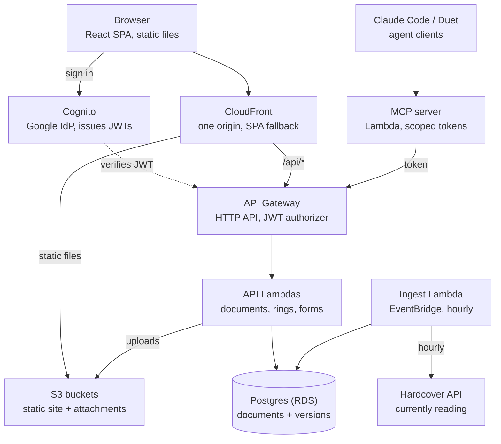

# Command Center — Design Brief

Oct 26, 2026 · Tyler

> This document is the constitution for the project. Each phase gets its own short
> directive under `docs/phases/` that cites it. Decisions recorded here are constraints,
> not suggestions, unless a phase surfaces a reason to revisit them.

## Purpose and principles

This is a personal system of record on AWS: a home for the things Tyler makes and keeps
(recipes, writing, small-group logistics, what he is reading and building) that currently
have no home, with a public face for the parts he chooses to show. It exists to be used
weekly and to sharpen AWS, infrastructure-as-code, and agent-integration skills. It is explicitly not a dashboard that re-aggregates Gmail, Slack,
Discord or calendar; Claude Duet already does that, and this site is where an agent
presents and stores, not what polls.

Principles that keep scope honest:

- **One primitive, many types.** Recipes, essays, surveys, briefs and notes are all
  versioned documents with a visibility ring. Build the primitive once; add types cheaply.
- **Verbs over views.** Every feature must be something Tyler opens to _do_ (save, draft,
  sign up, promote), not only to look at. A status widget needs a user story before it
  gets built.
- **API first, agents welcome.** Every capability is an authenticated endpoint before it
  is a screen. The web UI is one client; Claude (via MCP) is another.
- **Private by default, promotion is a human act.** Content is created in the `me` ring.
  Making anything public is a deliberate click no agent can perform.
- **Each phase ends deployed.** No phase is done until it is live at the real domain
  through CI.
- **Design for subtraction.** Features are independent enough to delete without the rest
  noticing.
- **Budget is a feature.** Target under $20/month; a billing alarm at $5 exists before any
  application code.

## Decisions made

These are settled unless a phase surfaces a reason to revisit. Claude Code should treat
them as constraints, not suggestions.

| Area                   | Decision                                                                                                                          | Why                                                                                                                                         |
| ---------------------- | --------------------------------------------------------------------------------------------------------------------------------- | ------------------------------------------------------------------------------------------------------------------------------------------- |
| Frontend               | TypeScript, React 19, Vite, Tailwind v4, shadcn/ui on Radix, react-hook-form + zod, TanStack Query, React Router                  | Conventions Tyler already knows well; static SPA needs no server                                                                            |
| Backend                | TypeScript on Node 22, Lambda functions behind API Gateway (HTTP API)                                                             | Learns the real AWS primitives; cost rounds to zero at this scale                                                                           |
| Database               | PostgreSQL on Aurora Serverless v2, min 0 ACU, accessed through the RDS Data API (decided Phase 1; see `docs/phases/01-spine.md`) | Versioned documents, diffs, tags and relations are relational; DynamoDB would fight the domain model; pausing at zero keeps it under budget |
| Object storage         | S3 for uploads (resume PDF, recipe photos, attachments), served through CloudFront                                                | Documents reference S3 keys; never store blobs in Postgres                                                                                  |
| Static hosting         | S3 + CloudFront, SPA fallback via CloudFront Function                                                                             | No web server to run or patch                                                                                                               |
| Infrastructure as code | AWS CDK in TypeScript, in the same repo                                                                                           | One language across the stack; `cdk diff` on every PR                                                                                       |
| CI/CD                  | GitHub Actions, OIDC federation to AWS (no long-lived keys), deploy on merge to `main`                                            | The pipeline shape a bank would recognize                                                                                                   |
| Auth (people)          | Cognito user pool with Google as federated IdP; allowlist table decides roles                                                     | Members sign in with the Gmail they have; no passwords to manage                                                                            |
| Auth (agents)          | Per-agent API tokens with explicit scopes, separate from human sessions                                                           | Agents are first-class clients with a smaller blast radius                                                                                  |
| Agent surface          | MCP server on Lambda wrapping the public API                                                                                      | Claude Code and Duet become ingest paths, not just consumers                                                                                |
| Reading feed           | Hardcover GraphQL API (Goodreads API is closed)                                                                                   | Only maintained option with a real API                                                                                                      |
| Monorepo               | pnpm workspaces: `apps/web`, `apps/api`, `packages/shared`, `infra`                                                               | Shared zod schemas between client, server and MCP                                                                                           |
| Formatting             | Prettier + ESLint flat config from day one                                                                                        | Formatting drift is cheaper to prevent than fix                                                                                             |
| Testing                | Vitest + RTL + MSW for web; Vitest for API; CDK snapshot tests for infra                                                          | Familiar shape; keep the custom render pattern                                                                                              |
| Observability          | CloudWatch logs + a single dashboard; structured JSON logs                                                                        | Enough to debug a Lambda at 11pm; nothing more yet                                                                                          |

## Domain model

Everything the site stores is a **document**: a typed, versioned, ring-scoped record.
Recipes, essays, surveys, briefs and notes are types of document, not separate modules.
Build the document tables and API once in Phase 1; every later type is a schema plus a
renderer.

**Document** holds identity and policy: `id`, `type`, `slug`, `ring` (me / group /
public), `owner`, `created_at`, `current_version_id`, `tags[]`, `deleted_at` (soft delete).
Promoting to a wider ring is a document-level change, not a version.

**Version** is append-only: `id`, `document_id`, `number`, `body` (markdown),
`frontmatter` (jsonb, validated against the type's zod schema), `author` (a person or an
agent token), `created_at`, `summary` (one line, "added smoked paprika"). Saving never
overwrites; it inserts. A diff between any two versions is computed from `body` plus a
jsonb diff of `frontmatter`.

**Attachment** links a version to an S3 object: `version_id`, `s3_key`, `content_type`,
`size`, `alt`.

**Type schemas** live in `packages/shared` as zod objects and are the single source of
truth for client validation, server validation, the MCP tool definitions, and the
frontmatter column. Initial types:

| Type     | Frontmatter (beyond body)                         | Default ring | Notes                                                                                        |
| -------- | ------------------------------------------------- | ------------ | -------------------------------------------------------------------------------------------- |
| `recipe` | servings, prep/cook minutes, ingredients[], tags  | me           | Versions are the point; public ring renders the current version with a "history" affordance  |
| `essay`  | title, subtitle, status (draft / revised / final) | me           | Writing lives here; publishing is promotion to public                                        |
| `note`   | title                                             | me           | Short, informal; the "what I'm working on" feed is notes promoted to public                  |
| `survey` | questions[] (typed), closes_at, allow_anonymous   | group        | Responses are their own table, keyed by survey document and either a member or a share token |
| `signup` | slots[] (label, capacity), closes_at              | group        | Dessert sign-ups and the like; claims are rows, not versions                                 |
| `brief`  | date, sections[]                                  | me           | Written by an agent token; the dashboard renders today's                                     |
| `page`   | title                                             | public       | Resume, about, bookstore list; versioned like everything else                                |

**Members and agents** are separate tables. `member`: email, role (admin / group),
display name. `agent_token`: name, hashed secret, scopes[], last_used_at, revoked_at. A
version's `author` references one or the other, so history always says who, human or
machine.

**Response and claim** tables (for surveys and sign-ups) are the only non-document data
in Phase 2 and are deliberately boring: rows with a foreign key to the document and either
a member or a share token.

**Reading** is not a document type. It is a cache table filled hourly from Hardcover and
rendered as a feed; nothing in it is authored here.

## Architecture

_The web UI and agents share one API; everything lands in Postgres._

_One repo. GitHub Actions deploys every box above through CDK on merge to main._

system architecture · 11 components, one API

CloudFront is the single origin: it serves the SPA and attachments from S3 and routes
`/api/*` to API Gateway, which keeps the app on one domain with no CORS. Browsers and
agents hit the same API; only their credentials differ. Postgres is the one place authored
data lives.

Three request paths worth naming for Claude Code:

1. **A member saves a recipe version.** Browser → CloudFront
   `/api/documents/:id/versions` → API Gateway validates the Cognito JWT → `documents`
   Lambda checks the member's ring against the document, validates frontmatter with the
   shared zod schema, inserts a version row, updates `current_version_id`. Attachments go
   up through a presigned S3 URL the same Lambda issues.
2. **An agent posts the morning brief.** Claude → MCP server Lambda with a scoped token →
   MCP translates `create_document(type: brief)` into the same `/api/documents` call with
   the agent's token → the API records the agent as author. The dashboard renders the
   newest `brief` in the `me` ring on next load.
3. **A public visitor reads an essay.** Browser → CloudFront → `/api/public/essays/:slug`
   → a `public` Lambda with no authorizer that only ever reads documents whose ring is
   `public` and returns the current version. Public reads are cacheable at CloudFront for
   an hour.

What runs where: every Lambda is a TypeScript handler bundled by CDK's `NodejsFunction`,
in a VPC only when it talks to RDS (the public read path and the MCP server can stay
outside the VPC and call the API over HTTPS). One `ingest` Lambda on an hourly EventBridge
rule pulls Hardcover into a cache table. Nothing is always-on except the database.

## Auth and access rings

Authentication answers "who is this" and is outsourced to Cognito (people) or a hashed
token (agents). Authorization answers "what may they see or do" and is entirely our code:
a document's `ring` plus the caller's role. Keep the two apart in the codebase; one
middleware resolves identity, a second resolves permission.

| Ring     | Who                       | How they authenticate                                                                        | What they can do                                                                                      |
| -------- | ------------------------- | -------------------------------------------------------------------------------------------- | ----------------------------------------------------------------------------------------------------- |
| `public` | Anyone                    | Nothing                                                                                      | Read documents whose ring is `public`; submit to surveys or sign-ups via a share token                |
| `group`  | Members with role `group` | Cognito + Google; email must be on the `member` allowlist                                    | Read `group` and `public` documents; respond to surveys, claim sign-up slots, view the group calendar |
| `me`     | Tyler, role `admin`       | Cognito + Google; exactly one allowlisted admin email                                        | Everything: create and version any document, promote or demote rings, manage members and agent tokens |
| `agents` | Named agent tokens        | `Authorization: Bearer <token>`, hashed at rest, presented to the MCP server or API directly | Only the scopes on the token; never promotion to `public`, never member or token management           |

**Agent scopes** are verbs on types: `read:documents`, `write:recipes`, `write:briefs`,
`write:notes`, `read:reading`. A token for Duet might carry `write:briefs read:documents`.
A token for a Claude Code session working on recipes carries `write:recipes`. Scopes are
checked after identity and before any handler logic. Every version an agent writes records
the token name as `author`, and the admin UI lists recent agent activity separately from
human activity.

**Share tokens** are per-document, unguessable URL tokens (`/s/x8f2k...`) that grant
`public`-ring access to one `group` document for the purpose of responding. They exist so
a dessert sign-up never requires login. They expire with the document's `closes_at` and
can be revoked by rotating the token.

**Fallback for members without Google**: Cognito's custom auth flow with a one-time
emailed code via SES. Build this only when a real member needs it; design the `member`
table so it needs no change.

**Implementation notes for Claude Code**: API Gateway's JWT authorizer validates Cognito
tokens before any Lambda runs, so handlers receive a verified `email` claim. Agent tokens
bypass the JWT authorizer on a separate route prefix (`/api/agent/*`) and are verified by
a Lambda authorizer that looks up the hash and returns the scopes as context. Both paths
converge on the same handlers with a normalized `caller` object:
`{ kind: 'member' | 'agent', id, role?, scopes? }`.

## Phases

_Six phases, each live at the domain before the next begins._

| Phase                 | Scope                                                                                             | Gate                                           |
| --------------------- | ------------------------------------------------------------------------------------------------- | ---------------------------------------------- |
| Phase 0 · Foundation  | Repo, CDK, S3 + CloudFront, domain, GitHub Actions via OIDC, billing alarm, a page with your name | A merge to main is live at the domain          |
| Phase 1 · Spine       | Postgres, documents + versions, recipe type, diffs, admin login (Cognito, one allowlisted email)  | Save and diff two chili versions in production |
| Phase 2 · Agents      | Agent tokens with scopes, MCP server on Lambda, brief type, agent activity in the admin UI        | Claude saves a recipe through MCP              |
| Phase 3 · Group       | Group ring, member allowlist, surveys, sign-ups, share tokens, group calendar                     | The small group answers a real survey          |
| Phase 4 · Public face | Public read API, resume page, essays and notes feeds, dark mode, the design values applied        | Resume and an essay are public                 |
| Phase 5 · Feeds       | Hardcover ingest, Ishar status, calendar sync, whatever earns its place                           | The reading feed updates without you           |

roadmap · 6 phases, a gate on each

Each phase is its own Claude Code directive and its own set of PRs; a phase is done when
its gate is true in production, not when the code merges. Phases 3 and 4 can swap if the
small group's needs push harder than the resume.

**Phase 0** is deliberately small and teaches the most AWS per hour. It includes the CDK
bootstrap, a `cdk diff` check on PRs, the GitHub OIDC role, the billing alarm, and the
Prettier/ESLint/Vitest skeleton. No application code beyond a static page.

**Phase 1** builds the spine: the `document`, `version`, `attachment`, `member` and
`agent_token` tables (agent tokens unused until Phase 2 but shaped now), the shared zod
package, the documents API, the Cognito user pool with Google and a single admin, a
minimal logged-in UI to create, version, and diff a recipe. Admin-only; nothing is public
yet.

**Phase 2** adds the agents ring: token issuance and revocation in the admin UI, the Lambda
authorizer, the MCP server exposing `list_documents`, `get_document`, `create_document`,
`create_version`, and the `brief` type. The first real use is saving a recipe from a
Claude Code session.

**Phase 3** opens the group ring: the member allowlist UI, `group` role in Cognito, the
`survey` and `signup` types with their response and claim tables, share tokens, and a
calendar view. This is the phase that pays back the original survey.

**Phase 4** is the public face: the unauthenticated read path with CloudFront caching, the
resume `page`, promotion UI for essays and notes, the public feeds, and the full
design-token pass with dark mode. This is where the design values from "Yours to decide"
land.

**Phase 5** is open-ended: the Hardcover ingest Lambda first, then anything that proves it
earns weekly use. Each feed is its own Lambda and cache table, deletable without ceremony.

## Yours to decide

These are the choices Claude Code must not make for you. Fill them in before Phase 4 at
the latest; the first two before Phase 0 so the repo is named and owned correctly.

**Name and domain.** What the site is called and the domain it lives at. The repo, the CDK
stack names, and the Cognito domain prefix all derive from it.

- [x] Name: The Keep
- [x] Domain: `tylerfuqua.com`, registered in Route 53 (Oct 26, 2026)

**AWS account.** New account or existing? Accounts created before July 15, 2025 are on the
legacy 12-month free tier; newer accounts get credits instead. This changes whether RDS is
free for a year.

- [x] Account: new, `697941679713`, created Oct 2026 (credits, not the legacy free tier)

**Design values** (the token architecture is inherited; these are the numbers that make it
yours):

- [ ] Primary color and its hover/active steps
- [ ] Body typeface: keep Source Sans 3, or something warmer
- [ ] Long-form typeface for essays and book notes: serif or not, and which
- [ ] Radius scale: one value for controls, one for cards
- [ ] Dark palette designed as its own thing: background, surface, text, muted, border
- [ ] Logged-in home: what the first screen shows (recommended: recent documents + a text
      box, not widgets)

**Open questions** (not blocking Phase 0 or 1):

- [x] Aurora Serverless v2 free tier: confirmed on the AWS pricing page, or stay on RDS
      db.t4g.micro? Aurora Serverless v2 at min 0 ACU (Oct 26, 2026).
- [ ] Hardcover API: create an account and confirm the GraphQL endpoint exposes "currently
      reading" and shelves
- [ ] Duet integration path: does Duet reach external MCP servers today, or does the brief
      arrive via a scheduled Claude Code task posting to the API? Design the `brief` type
      and `write:briefs` scope either way
- [ ] Daily Office: which lectionary source, and is it a feed on the dashboard or a `page`?
- [ ] Calendar: Google Calendar API sync into the group ring, or a hand-maintained `event`
      document type?
- [ ] Recipe diff rendering: unified text diff only, or a structured ingredient diff too?
      (Start unified; revisit after five versions of chili)

## Frontend conventions

Tailwind's own neutral ramp and tone values, an openly licensed font, and a strict token
discipline. These are ordinary choices, written here so the stack stays consistent from
one phase to the next. Composed components are written from their spec, never pasted
from elsewhere.

| Use                                                                                                                                                                               | Add                                                                                                                              | Avoid                                                                                                 |
| --------------------------------------------------------------------------------------------------------------------------------------------------------------------------------- | -------------------------------------------------------------------------------------------------------------------------------- | ----------------------------------------------------------------------------------------------------- |
| Tailwind v4 `@theme` block in `index.css` as the single token source; semantic names only, no raw palette classes                                                                 | Primary color and nav palette as tokens with hover/active steps                                                                  | A sprawling API client; write a thin typed fetch for the Lambda API                                   |
| Neutral ramp (`background`, `foreground`, `muted`, `border`, `input`, `disabled`) and five tone families with fill/text/subtle/border steps                                       | Dark mode from day one via `@custom-variant dark` on a `data-theme` attribute                                                    | Third-party auth gates, feature-flag services                                                         |
| Self-hosted font via fontsource; Tailwind default type scale; weight-over-size hierarchy; eyebrow recipe (`text-xs font-semibold uppercase tracking-wider text-muted-foreground`) | `--radius-*` tokens so Button and Card never encode radius inline                                                                | Operations-tool patterns (table params hooks, pagination widgets) the domain does not need            |
| `cn()` helper, `@/` alias, strict `tsconfig` flags (`noUnusedLocals`, `verbatimModuleSyntax`, `erasableSyntaxOnly`), ESLint flat config                                           | AppShell: `h-screen flex-col` → `main overflow-y-auto`, a single `md` breakpoint, top nav rather than a sidebar                  | `@hookform/resolvers` without a schema lib, the unused `cn` npm package, `tw-animate-css` unless used |
| Vitest + RTL + MSW with `onUnhandledRequest: 'error'`; custom render injecting QueryClient, router, auth; three-job CI shape (test, lint, typecheck)                              | Forms: react-hook-form with zod + `zodResolver` and the shadcn Form wrapper                                                      | Storybook (a maintenance tax for a 15-component solo project)                                         |
| Form row pattern: `grid gap-2` → Label → Input → `text-xs text-muted-foreground` hint → `text-sm text-destructive` error                                                          | Small composed components written from spec: Alert, StatusBadge, FormSheet, ConfirmDialog, DetailRow, SearchInput, FlashMessages | Mixing the radix-ui umbrella with `@radix-ui/react-*`: pick `@radix-ui/react-*` and stay consistent   |
| S3 double-sync (no-cache on root files, `max-age=31536000, immutable` on `assets/*`) plus CloudFront invalidation                                                                 | Prettier from day one                                                                                                            | Committed `.env.<mode>` files; use CDK outputs and SSM parameters instead                             |
| TanStack Query 5 with `staleTime` 30s, `retry` 1, one file per resource in `src/api/` with a `<resource>Keys` factory                                                             | `table.tsx` as a pure primitive with no sorting import                                                                           | Any third-party brand asset, copy, logo or product name                                               |

## Working with Claude Code

This brief is the constitution; each phase gets its own short directive that cites it.
Export this doc to Markdown and commit it as `docs/DESIGN.md` in Phase 0, so every Claude
Code session can read it from the repo rather than from a pasted prompt.

**Shape of a phase directive** (one file per phase, `docs/phases/0N-<name>.md`, under a
page):

1. The gate, stated first, as a test a human can run in production.
2. In scope / out of scope, with the out-of-scope list being the longer one.
3. The decisions from this brief that the phase touches, by name, so the session does not
   relitigate them.
4. Concrete deliverables as a checklist, each small enough to be one PR.
5. What to ask Tyler about versus what to decide and flag. Default: decide and flag in the
   PR description; ask only when a choice cannot be undone (schema shape, token format, a
   public URL).

**`CLAUDE.md` at the repo root** should stay under a page and point to `docs/DESIGN.md`.
It carries only what every session needs on every turn: the monorepo layout, how to run
tests and `cdk diff`, the token-only styling rule, the rule that schemas live in
`packages/shared`, and the rule that no agent path can promote a document to `public`.

**Guardrails for every session:**

- Never run `cdk deploy` from a local session; deploys happen from `main` through GitHub
  Actions. Local sessions run `cdk synth` and `cdk diff` only.
- Never commit secrets, `.env` files, or AWS credentials. Configuration comes from CDK
  outputs and SSM.
- Every new document type is a zod schema in `packages/shared` first, then a migration,
  then a renderer. Never the reverse.
- Every Lambda gets a test that calls the handler with a fake event; every CDK stack gets
  a snapshot test.
- Prefer deleting a feature to maintaining one that is not used. If a phase's gate stops
  being true, say so.

**A note on pace.** Phases are sized for evenings and the occasional Saturday morning. If
a phase runs past two weeks of real work, the directive is too big; split it rather than
push through.
